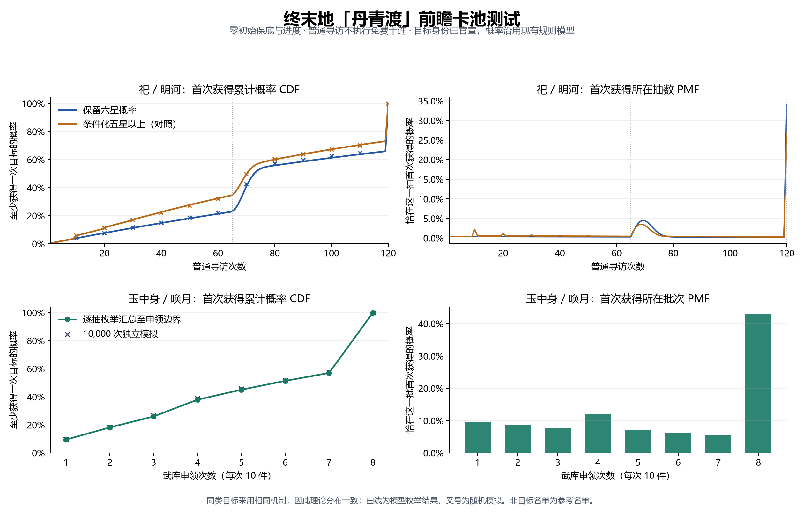

# 丹青渡独立接入与概率报告

此案例作为独立开发者项目消费公开 SDK。接入方使用独立的官方游戏资料库，通过第一方接口完成概率分析、模拟、trace、会话续跑和 JSON/CSV 导出。

角色与武器身份依据[官方导览](https://endfield.hypergryph.com/version_briefing/latest)，版本日期依据[研发通讯](https://endfield.hypergryph.com/news/3805)。核对资料见[摘要](../../../official/gacha-games/tools/reviews/danqingdu-20261011.json)。

## 接入口径

- 独立项目：[接入示例](README.md)，具有自己的工作区、锁文件、场景配置，卡池资料由官方库提供。
- 接入代码依赖公开 SDK 与官方资料库，不实现抽样、分布计算、动作汇总或统计对照。
- `tools/check_examples.py` 将项目复制到仓库外运行，六个场景各模拟 10,000 个独立初始账户；再在相同独立目录调用公开 CLI 核对分析、trace 与续跑。
- 普通寻访从零保底和零进度开始，不执行免费十连，不计阶段信物；武器按完整申领统计，不计阶段赠礼。
- 完整新版本陪跑名单尚未核实，数据包沿用参考非目标名单，仅用于当期目标的首次获得概率。两种角色模型及武器末抽补位假设随 SDK 报告一起输出。

## 概率分布



## SDK 返回的期望与分位数

| 目标 | 模型 | 期望完整动作 | 50% | 90% | 95% | 99% | 100% |
| --- | --- | ---: | ---: | ---: | ---: | ---: | ---: |
| 祀 | 保留六星概率 | 81.376 | 73 | 120 | 120 | 120 | 120 |
| 祀 | 条件化五星以上（对照） | 74.099 | 71 | 120 | 120 | 120 | 120 |
| 明河 | 保留六星概率 | 81.376 | 73 | 120 | 120 | 120 | 120 |
| 明河 | 条件化五星以上（对照） | 74.099 | 71 | 120 | 120 | 120 | 120 |
| 玉中身 | 武库批次模型 | 5.547 | 6 | 8 | 8 | 8 | 8 |
| 唤月 | 武库批次模型 | 5.547 | 6 | 8 | 8 | 8 | 8 |

角色单位为普通寻访次数，武器单位为完整申领次数。同类目标使用相同机制与起点，理论分布一致；各场景独立运行。

## 完整动作累计概率

| 申领次数 | 玉中身 / 唤月 CDF | 首次获得该批 PMF |
| ---: | ---: | ---: |
| 1 | 9.562% | 9.562% |
| 2 | 18.209% | 8.648% |
| 3 | 26.030% | 7.821% |
| 4 | 37.987% | 11.957% |
| 5 | 45.087% | 7.100% |
| 6 | 51.395% | 6.309% |
| 7 | 57.000% | 5.604% |
| 8 | 100.000% | 43.000% |

## 复现

在仓库根目录：

```sh
cargo build -p gacha-cli --release --locked
python tools/check_examples.py
python examples/sdk/endfield-danqingdu/plot.py
```

也可进入示例目录执行 `cargo run --release --locked -- 10000`。图表仅读取 SDK 返回的分布与汇总，不执行概率算法。

[独立运行证据](reports/verification.json)记录工作区隔离、源文件未变化、六个场景及 CLI/SDK 一致性。性能与理论依据见[算法说明](../../../docs/PERFORMANCE.md)，SDK 契约见[接入文档](../../../docs/SDK.md)。

## 原始输出

| 场景 | SDK 报告 | CSV | Trace |
| --- | --- | --- | --- |
| 祀 / 保留六星概率 | [报告](reports/si-fixed-five.json) | [分布](reports/si-fixed-five.csv) | [追踪](reports/si-fixed-five.trace.json) |
| 祀 / 条件化五星以上（对照） | [报告](reports/si-proportional.json) | [分布](reports/si-proportional.csv) | [追踪](reports/si-proportional.trace.json) |
| 明河 / 保留六星概率 | [报告](reports/minghe-fixed-five.json) | [分布](reports/minghe-fixed-five.csv) | [追踪](reports/minghe-fixed-five.trace.json) |
| 明河 / 条件化五星以上（对照） | [报告](reports/minghe-proportional.json) | [分布](reports/minghe-proportional.csv) | [追踪](reports/minghe-proportional.trace.json) |
| 玉中身 / 武库批次模型 | [报告](reports/yuzhongshen-weapon.json) | [分布](reports/yuzhongshen-weapon.csv) | [追踪](reports/yuzhongshen-weapon.trace.json) |
| 唤月 / 武库批次模型 | [报告](reports/huanyue-weapon.json) | [分布](reports/huanyue-weapon.csv) | [追踪](reports/huanyue-weapon.trace.json) |
